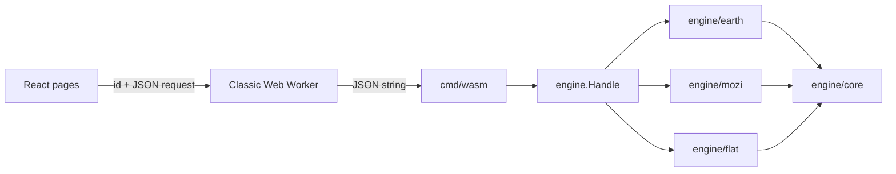

# Architecture

The deliverable is `dist/`: static HTML, CSS, JavaScript, fonts, a WASM binary and license notices, for S3 behind CloudFront. No server.

## Engine

`engine.Handle(json) json` answers `{"action":"simulations"}` and, per simulation, `{"sim":"earth"|"mozi"|"flat","action":"catalog"|"run", ...}`. A refusal is `{"error": message, "field": path}`; nothing panics or leaks a Go error across the boundary.

`engine/core` defines `Slot` (an aspect), `Model`, `Param` and `Preset`, and `Catalog.Resolve`, which layers defaults, a preset and the request's overrides and validates them. `Catalog.Check` catches descriptor mistakes and runs in tests.

`engine/earth.Run` takes `{life, preset, models, params, resolution}` and returns 481 samples of each series (`temperature`, `equilibrium`, `co2`, `o2`, `n2`, `ocean`, `stratosphere`, `loss`, `land`, `biology`, `productivity`, `shield`, `luminosity`, and the display-only `melt`, `ice`, `vegetation`), named events, a summary and the resolved choice. The first 40 samples cover the first 20 million years so the molten start is visible; the rest are evenly spaced.

At each step the carbon cycle is solved as a balance (weathering equals outgassing) for the CO2 pressure, since it settles far faster than the step. When the productivity feedback gives several balances, the one nearest the previous step's is kept. Water is integrated explicitly, with no step allowed to remove more than 1% of an ocean. Once the water is gone weathering stops and CO2 accumulates from outgassing. `resolution` sets the substeps per sample (2 or 12).

`engine/earth/terrain.Run` evolves a patch of land (`{scene, params}`) and returns 25 frames of heights plus the vegetation cover. Those arrays are large, so they do not travel as JSON: `engine.Terrain` returns them beside the JSON reply, `cmd/wasm` exposes that as `threeBodyTerrain` returning `{json, heights, cover}` with `Float32Array`s, and the worker transfers their buffers. `{"action":"terrain-catalog"}` describes the scenes and parameters.

`engine/earth/chance.Run` computes a chunk of the ensemble (`{seed, from, count, runs, params}`) and returns how many runs each planet survived, by chance alone and with life's thermostat. A planet and its accidents depend only on the seed, the planet's number and the run, so any split into chunks gives the same answer; `{"action":"chance-catalog"}` describes the parameters.

`engine/mozi.Run` takes `{preset, models, params, resolution}` and returns the clerk's calendar (one record per sunrise: when, the day's length, daylight, the sun's widest and the light received, and whether the clerk counts it regular), the eras read from it, the standard day, the star field and a summary. The machine is closed-form in time, so nothing is integrated. `engine/mozi.Sky` takes the same choice plus `{from, step, count}` and returns up to 1,000 frames of the machine's state for the views: the sun's direction, width and brightness, each shell's attitude as a quaternion and its radius, the hole's width and the flying stars. Both replies are small enough for JSON.

`engine/flat.Run` takes `{body, preset, models, params, resolution}` and returns one body's fall: its flat size, how long it takes, when the picture is wider than what is left, the rings, and 97 (coarse) or 385 (fine) frames of the plane's height, the footprint, the rim and every band's edge, and 25 more (`early`) from first touch to the crossing, which on a thin sheet comes microseconds in, far inside the first of the evenly spaced ones. Everything is closed form; the volume of the caps that have gone under is written so that nothing large is subtracted from anything large, because on a sheet an atom thick a rounding error in a sliver would be a picture millions of kilometers wide. `engine/flat.Sky` takes the same choice and a seed and returns every body's place, flat size, bands and turn to fall. Both are small JSON.

Pictures do not travel as JSON. `engine.Bytes(request, in)` answers `{"sim":"flat","action":"painting", width, height, ...}` with the picture as RGBA bytes beside it, and `"snowflakes"`; its reply's JSON says where each picture and the mesh of the fall lie in the bytes that come back beside it. `cmd/wasm` exposes it as `threeBodyBytes(json, Uint8Array?)` returning `{json, bytes}`, and the worker hands buffers over in both directions (`Engine.ask(request, bytes)`).

## Interface

The home page lists the simulations only after a visitor acknowledges a spoiler warning. The acknowledgement lasts for the visit and is not stored; a link straight to a simulation is not held up. `web/shell/App.tsx` owns the one engine worker, hash routes (`#/`, `#/<sim>`, `#/<sim>/…`) and the registry of lazily loaded simulations. `html[data-engine="ready"]` marks a started engine; a failed start offers a retry.

A view keeps its address in step with its settings through `setAddress` (`web/shell/address.ts`), which rewrites the address without a history entry and so without a `hashchange`. The shell therefore counts arrivals: every `hashchange` re-reads the address and adds one to `arrival`, which each view that reads its address once is keyed by. A link followed, pasted over the open page, or gone back to is read afresh, even when it is the address the page was first opened at; a view's own rewriting is not an arrival and never remounts it. A page the visitor has not been to opens at its top with focus moved to it (`.view`); each history entry is marked seen, so Back and Forward are left to the browser.

Sliders are drawn from a parameter's descriptor by `scale` (`web/shell/catalog.ts`): logarithmic ones slide in log10, a `whole` one moves in whole numbers, and a stop within half a step of the value the chosen starting point gives the parameter is that value. A parameter put back there is no longer an edit (`withParam`, `web/shell/study.ts`). Charts that move the page to where they are pointed at share `useScrub` (`web/shell/scrub.ts`): a mouse scrubs as it hovers or drags, a finger only on a tap or once it has set off sideways, so a swipe that scrolls past a chart moves nothing.

The Earth page keeps one `Study` (Life, preset, edits, resolution). Each change reruns both Earths after 120 ms; a sequence number drops superseded replies. The study is mirrored into the address as `#/earth?c=<base64url JSON>`; an arriving link is validated key by key against the catalog and falls back to the default with a notice. Controls are rendered from the catalog. The globe is a three.js sphere with one procedural shader fed by `look.ts`; without WebGL it is a flat disc. Charts are plain SVG, one measure each, both Earths on each, with a table view. On a wide screen both Earths' globes are shown side by side.

`#/earth/surface` is the surface view (`Surface.tsx`, `Terrain.tsx`): a three.js height field recolored per frame, with a shaded map as the fallback. The planet view links to it with the current moment's plant cover and rain in the query string, which is validated against the terrain catalog on arrival.

`#/earth/chance` is the ensemble (`Chance.tsx`). It shares the planets out in chunks of 25 among the site's engine and up to three more, each in its own worker, shows progress, and can be stopped; a token discards replies from a run that has been replaced. The planet and surface views send requests through `useLatest` (`web/shell/useLatest.ts`), which runs one at a time and only ever the newest, so a dragged slider never leaves a queue of runs behind it.

`#/mozi` is Mozi's machine (`web/sims/mozi`). One `useLatest` request carries the study and the day the frames start: the calendar is asked for again only when the study changes, and frames arrive three days at a time, a quarter of an hour apart, as the clock moves. Both views are drawn from a `View` read between two frames, never from the model re-implemented in TypeScript; while a newer window is on its way the last moment drawn stays up. `Sky.tsx` is a 2D canvas of the whole sky from the center. `Machine.tsx` is a three.js cutaway, drawn only when something changes, whose layers can be hidden; the inside of the inner shell takes the sky's color. Without WebGL it is an SVG cross-section through the sun. On a narrow screen, Play scrolls the clerk's sky to the top and docks the timeline at the bottom; the dock stays through a pause or a scrub and is put away by the first scroll made while time stands still. The study travels as `#/mozi?c=…`, validated like Earth's. The catalog types and the slider both simulations use are in `web/shell` (`catalog.ts`, `Slider.tsx`).

`#/flat` is the fall into two dimensions (`web/sims/flat`), in three views that share tabs: a body (`FlatPage.tsx`, `Fall.tsx`), a painting (`Painting.tsx`, `Sheet.tsx`) and the whole sky (`SkyView.tsx`). Each keeps a study in `?c=…` beside its own keys (`body`, `seed`), all validated on arrival; a view is keyed by the arrival, so a link followed from inside the page is read too. The body and sky views are 2D canvases drawn from the engine's frames. The first three tenths of the body's timeline run up to the moment the flat picture is as wide as the body, and the rest runs evenly to the end, because the picture's growth is over almost at once while the body takes the whole fall to go under; the view opens at that moment and Play takes forty seconds. When the view has pulled back so far that the body is a speck, it is drawn again in a corner at a fixed scale. Choosing a preset turns to the body the catalog's `focus` names for it. Each body's face (`Ball.ts`) is one of NASA's maps from `public/planets` wrapped around a ball, or, until it loads and where there is none, a likeness made from the catalog's `surface` description. The side view, the sky's reach and its brush strokes travel in the link as `view`, `show` and `plain`. The painting is read with `createImageBitmap` from the chosen file, shrunk to 320 dots and sent to the engine as bytes; it is never uploaded, and no blob URL is used for display, so the policy below needed no change. `Sheet.tsx` draws the engine's mesh with a small WebGL program, moving each row of the picture along its path as the fall plays; without WebGL it shows the engine's own finished picture. The study codec both newer simulations use is `web/shell/study.ts`.

## Security policy

`deploy/content-security-policy.txt` is sent by `vite preview`, so browser tests run under it. It allows same-origin resources and WASM only. CloudFront sends the same text as an HTTP header, set in `iwvelando/cloud-accounts` (`sites/three-body.isaacvelando.com`); the deploy job fails if the live header differs from the file. `style-src-attr 'unsafe-inline'` is there because WebKit reports a violation for native `<select>` controls without it.
