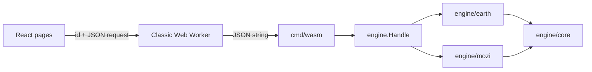

# Architecture

The deliverable is `dist/`: static HTML, CSS, JavaScript, fonts, a WASM binary and license notices, for S3 behind CloudFront. No server.

## Engine

`engine.Handle(json) json` answers `{"action":"simulations"}` and, per simulation, `{"sim":"earth"|"mozi","action":"catalog"|"run", ...}`. A refusal is `{"error": message, "field": path}`; nothing panics or leaks a Go error across the boundary.

`engine/core` defines `Slot` (an aspect), `Model`, `Param` and `Preset`, and `Catalog.Resolve`, which layers defaults, a preset and the request's overrides and validates them. `Catalog.Check` catches descriptor mistakes and runs in tests.

`engine/earth.Run` takes `{life, preset, models, params, resolution}` and returns 481 samples of each series (`temperature`, `equilibrium`, `co2`, `o2`, `n2`, `ocean`, `stratosphere`, `loss`, `land`, `biology`, `productivity`, `shield`, `luminosity`, and the display-only `melt`, `ice`, `vegetation`), named events, a summary and the resolved choice. The first 40 samples cover the first 20 million years so the molten start is visible; the rest are evenly spaced.

At each step the carbon cycle is solved as a balance (weathering equals outgassing) for the CO2 pressure, since it settles far faster than the step. When the productivity feedback gives several balances, the one nearest the previous step's is kept. Water is integrated explicitly, with no step allowed to remove more than 1% of an ocean. Once the water is gone weathering stops and CO2 accumulates from outgassing. `resolution` sets the substeps per sample (2 or 12).

`engine/earth/terrain.Run` evolves a patch of land (`{scene, params}`) and returns 25 frames of heights plus the vegetation cover. Those arrays are large, so they do not travel as JSON: `engine.Terrain` returns them beside the JSON reply, `cmd/wasm` exposes that as `threeBodyTerrain` returning `{json, heights, cover}` with `Float32Array`s, and the worker transfers their buffers. `{"action":"terrain-catalog"}` describes the scenes and parameters.

`engine/earth/chance.Run` computes a chunk of the ensemble (`{seed, from, count, runs, params}`) and returns how many runs each planet survived, by chance alone and with life's thermostat. A planet and its accidents depend only on the seed, the planet's number and the run, so any split into chunks gives the same answer; `{"action":"chance-catalog"}` describes the parameters.

`engine/mozi.Run` takes `{preset, models, params, resolution}` and returns the clerk's calendar (one record per sunrise: when, the day's length, daylight, the sun's widest and the light received, and whether the clerk counts it regular), the eras read from it, the standard day, the star field and a summary. The machine is closed-form in time, so nothing is integrated. `engine/mozi.Sky` takes the same choice plus `{from, step, count}` and returns up to 1,000 frames of the machine's state for the views: the sun's direction, width and brightness, each shell's attitude as a quaternion and its radius, the hole's width and the flying stars. Both replies are small enough for JSON.

## Interface

`web/shell/App.tsx` owns the one engine worker, hash routes (`#/`, `#/<sim>`, `#/<sim>/…`) and the registry of lazily loaded simulations. `html[data-engine="ready"]` marks a started engine; a failed start offers a retry.

The Earth page keeps one `Study` (Life, preset, edits, resolution). Each change reruns both Earths after 120 ms; a sequence number drops superseded replies. The study is mirrored into the address as `#/earth?c=<base64url JSON>`; an arriving link is validated key by key against the catalog and falls back to the default with a notice. Controls are rendered from the catalog. The globe is a three.js sphere with one procedural shader fed by `look.ts`; without WebGL it is a flat disc. Charts are plain SVG, one measure each, both Earths on each, with a table view. On a wide screen both Earths' globes are shown side by side.

`#/earth/surface` is the surface view (`Surface.tsx`, `Terrain.tsx`): a three.js height field recolored per frame, with a shaded map as the fallback. The planet view links to it with the current moment's plant cover and rain in the query string, which is validated against the terrain catalog on arrival.

`#/earth/chance` is the ensemble (`Chance.tsx`). It shares the planets out in chunks of 25 among the site's engine and up to three more, each in its own worker, shows progress, and can be stopped; a token discards replies from a run that has been replaced. The planet and surface views send requests through `useLatest` (`web/shell/useLatest.ts`), which runs one at a time and only ever the newest, so a dragged slider never leaves a queue of runs behind it.

`#/mozi` is Mozi's machine (`web/sims/mozi`). One `useLatest` request carries the study and the day the frames start: the calendar is asked for again only when the study changes, and frames arrive three days at a time, a quarter of an hour apart, as the clock moves. Both views are drawn from a `View` read between two frames, never from the model re-implemented in TypeScript; while a newer window is on its way the last moment drawn stays up. `Sky.tsx` is a 2D canvas of the whole sky from the center. `Machine.tsx` is a three.js cutaway, drawn only when something changes, whose layers can be hidden; the inside of the inner shell takes the sky's color. Without WebGL it is an SVG cross-section through the sun. On a narrow screen, Play scrolls the clerk's sky to the top and docks the timeline at the bottom; the dock stays through a pause or a scrub and is put away by the first scroll made while time stands still. The study travels as `#/mozi?c=…`, validated like Earth's. The catalog types and the slider both simulations use are in `web/shell` (`catalog.ts`, `Slider.tsx`).

## Security policy

`deploy/content-security-policy.txt` is sent by `vite preview`, so browser tests run under it. It allows same-origin resources and WASM only. CloudFront sends the same text as an HTTP header, set in `iwvelando/cloud-accounts` (`sites/three-body.isaacvelando.com`); the deploy job fails if the live header differs from the file. `style-src-attr 'unsafe-inline'` is there because WebKit reports a violation for native `<select>` controls without it.
